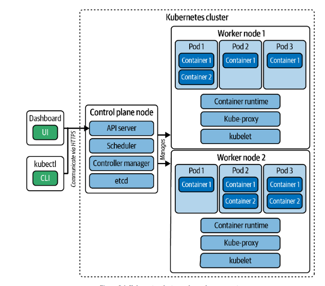

# Kubernetes Cluster Architecture (diagram + notes)

🎯 **Domain 01 — Cluster Architecture (25%).** The mental model for the whole exam:
what the control plane does, what a worker node does, and how a request flows.



*Saved from study material, 2026-10-27. Maps 1:1 to the `vagrant-kubeadm` lab:
control plane = `cp`, workers = `worker1` + `worker2`.*

---

## The two planes

A cluster splits into **control plane** (the brain — decides *what should happen*)
and **worker nodes** (the muscle — actually *run the containers*).

### Clients (left of the diagram)

- **`kubectl` (CLI)** and the **Dashboard (UI)** are *clients*. They don't live in
  the cluster — they talk to it **over HTTPS to the API server**. This is exactly
  why `kubectl` runs from your host or `cp`, never from a worker (see
  [`../../environment/using-the-cluster-with-kubectl.md`](../../environment/using-the-cluster-with-kubectl.md)).

### Control plane node (`cp`)

Everything here is **cluster brain**. In kubeadm these run as **static pods** under
`/etc/kubernetes/manifests/` on the control-plane.

| Component | Job | Exam-relevant notes |
|-----------|-----|---------------------|
| **API server** | The front door. **Every** request (kubectl, kubelet, controllers) goes through it. Only component that talks to etcd. | If it's down, `kubectl` fails cluster-wide. Check: `crictl ps | grep apiserver`. |
| **Scheduler** | Decides **which node** a new Pod runs on (based on resources, taints/tolerations, affinity). | It only *assigns*; the kubelet actually starts the pod. |
| **Controller manager** | Runs control loops that drive **actual state → desired state** (e.g. recreate a dead pod, maintain replica count). | "Reconciliation loop" is the core k8s idea. |
| **etcd** | The **database**. Key-value store holding the entire cluster state. | **Backup/restore is a high-value exam task** (`etcdctl snapshot save/restore`). Lose etcd = lose the cluster. |

### Worker nodes (`worker1`, `worker2`)

Where your workloads actually run. Each worker has three things (bottom of each
node box in the diagram):

| Component | Job |
|-----------|-----|
| **kubelet** | The node agent. Talks to the API server, starts/stops containers via the runtime, reports node + pod health. The thing that makes a node `Ready`. |
| **kube-proxy** | Programs the node's networking (iptables/IPVS) so **Service** virtual IPs route to the right pods. |
| **Container runtime** | Actually runs containers (containerd in this lab). kubelet talks to it via the CRI. |

### Pods & containers (top of each worker)

- A **Pod** is the smallest schedulable unit — it wraps **one or more containers**
  that share network + storage. (Diagram: Worker 1 / Pod 1 has Container 1 + 2.)
- Containers in the same pod share the pod's IP and can talk via `localhost`.

---

## How a request flows (memorize this)

`kubectl apply -f deploy.yaml` →
1. **kubectl** sends it to the **API server** (HTTPS, authenticated).
2. API server validates and **writes desired state to etcd**.
3. **Controller manager** sees "Deployment wants 3 pods, 0 exist" → creates Pod objects.
4. **Scheduler** sees unscheduled pods → assigns each to a node.
5. The target node's **kubelet** sees "a pod is assigned to me" → tells the
   **container runtime** to pull images and start containers.
6. **kube-proxy** wires up Service networking so traffic can reach the pods.

> Everything funnels through the **API server**, and all state lives in **etcd**.
> Those two are the heart of the cluster.

---

## Map to your lab (verified)

```
kubectl get nodes
NAME      STATUS   ROLES           VERSION
cp        Ready    control-plane   v1.37.1   <- API server, scheduler, controller-mgr, etcd
worker1   Ready    <none>          v1.37.1   <- kubelet + kube-proxy + containerd + pods
worker2   Ready    <none>          v1.37.1   <- (you configured this one by hand!)
```

- The **CNI (Calico)** that makes pods network across nodes is a cluster add-on —
  it self-propagates to every node via a DaemonSet (see
  [`labs/configuring-worker2.md`](labs/configuring-worker2.md) → "Did I need to
  configure the CNI? No").

---

## 30-second self-test

1. Which component does `kubectl` talk to? → **API server** (over HTTPS).
2. Where is all cluster state stored? → **etcd**.
3. What decides which node a pod lands on? → **scheduler**.
4. What actually starts the containers on a node? → **kubelet** (via the runtime).
5. What makes Service IPs route to pods? → **kube-proxy**.
6. Why can't you run `kubectl` on a worker? → workers have no admin kubeconfig;
   `kubectl` is a client of the API server, which lives on the control plane.
